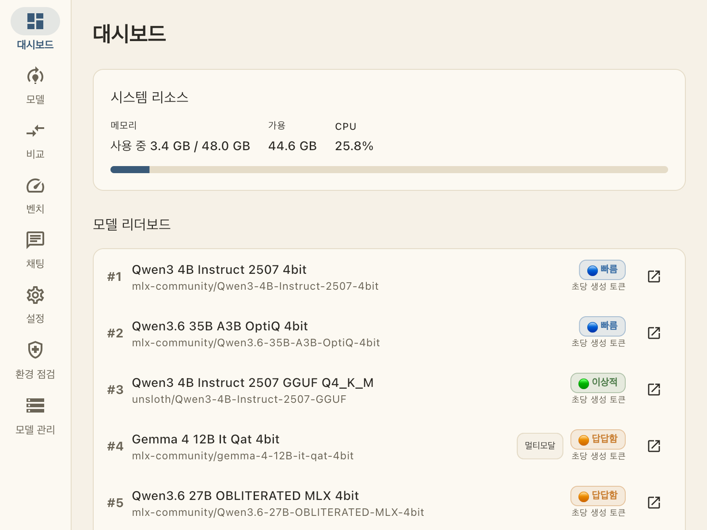
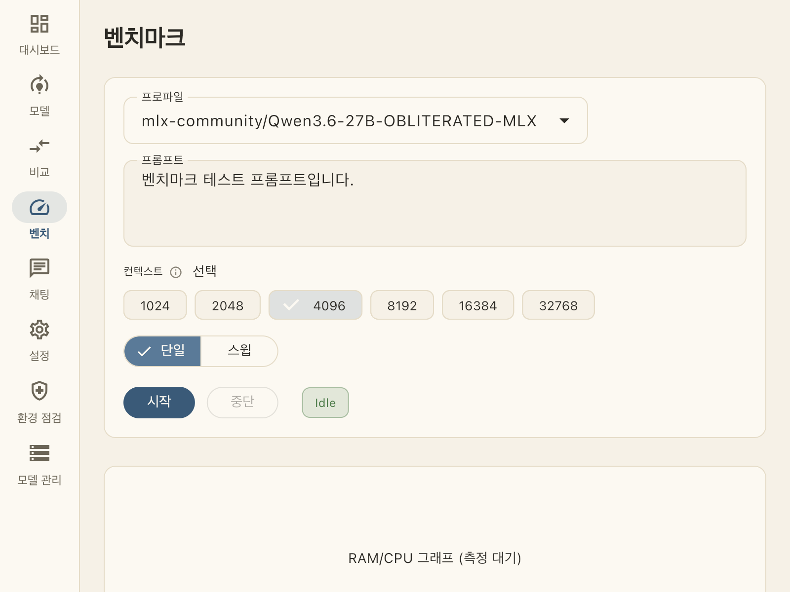
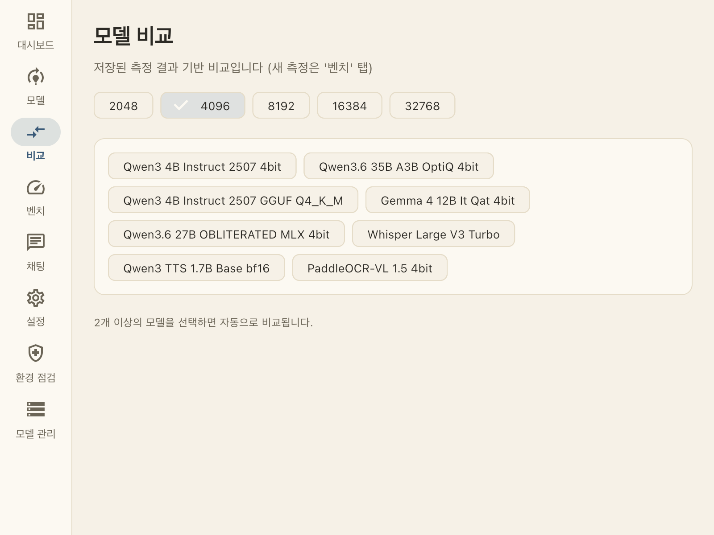
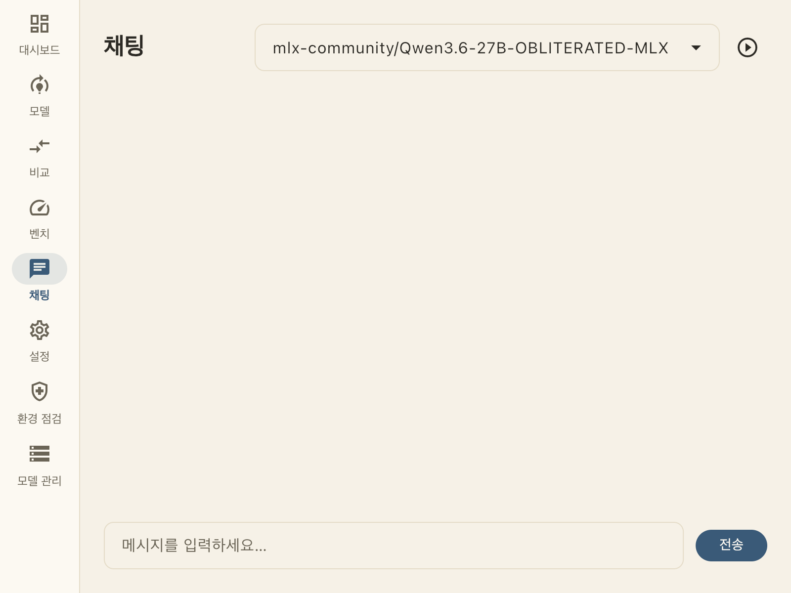
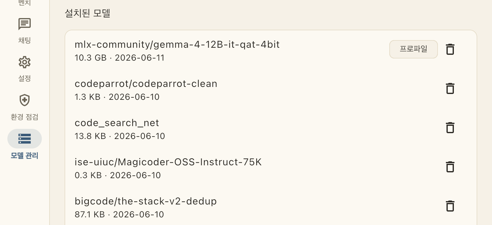

<h1 align="center">$\bf{\large{\color{#6580DD} MLX\ Benchmark\ Dashboard }}$</h1>

**Apple Silicon Mac에서 로컬 AI 모델의 TPS, TTFT, 메모리 사용량을 직접 측정하고 비교하는 데스크탑 앱입니다.**

추정식 대신 내 기기에서 모델을 실제로 실행해 얻은 값을 기록합니다. Hugging Face에서 모델을 검색해 설치하고, 태스크별 벤치마크를 돌린 뒤 결과를 리더보드와 비교 화면에서 확인합니다. 앱과 빌드 산출물 이름은 `AI Dashboard`입니다.


-black?style=flat-square&logo=apple)



<hr>

## 개발 환경

### Language


### Framework & Runtime


### Database


### AI & Model


<hr>

## 주요 기능

### 1. 실측 기반 벤치마크
- TPS(초당 생성 토큰), TTFT(첫 토큰까지 걸린 시간), Peak RAM, CPU 사용률을 측정 중에 실시간으로 샘플링합니다.
- 단일 측정과 컨텍스트 스윕(여러 컨텍스트 크기 연속 측정)을 지원하며, CLI에서는 한계 탐색, A/B 대결, 양자화 비교도 실행할 수 있습니다.
- 모든 지표 옆에 설명 아이콘이 있고, 누르면 지표 설명과 TPS 등급표를 보여줍니다.

### 2. 태스크별 테스트 환경

| 태스크 | 벤치 입력 | 핵심 지표 |
|---|---|---|
| 텍스트 생성 (LLM) | 프롬프트 + 컨텍스트 크기 | TPS, TTFT, Peak RAM |
| 멀티모달 (이미지+텍스트) | 프롬프트 + 이미지 | TPS, TTFT, Peak RAM |
| 음성→텍스트 (STT) | 오디오 파일 | 처리 시간, Peak RAM |
| 텍스트→음성 (TTS) | 합성 텍스트 | 처리 시간, Peak RAM |
| 이미지 생성 | 프롬프트 | 처리 시간, Peak RAM |

- 모델 태스크에 따라 입력 UI가 바뀝니다. STT 모델이면 오디오 선택, 멀티모달 모델이면 이미지 첨부 버튼이 나타납니다.

### 3. 메모리 와치독
- Rust 코어가 자원 사용량을 감시하다가 soft 한도에서 경고하고, hard 한도에 닿으면 모델 프로세스를 즉시 종료합니다.
- 서버 시작, 측정, 정지, 언로드까지 한 사이클을 코어가 관리합니다.

### 4. 비교와 기록
- 측정 결과는 SQLite에 자동 저장되고, 대시보드 리더보드와 비교 탭에서 모델 2개 이상을 지표별로 나란히 볼 수 있습니다.
- 서로 다른 태스크의 모델을 섞어 비교하면 참고용이라는 안내가 표시됩니다.
- 결과 카드를 HTML로, 측정 기록을 JSON/CSV로 내보낼 수 있습니다.

### 5. 채팅과 모델 관리
- 측정한 모델과 바로 채팅해 응답을 확인할 수 있습니다. 채팅을 지원하지 않는 모델(STT 등)을 고르면 벤치 탭으로 안내합니다.
- Hugging Face 모델을 한국어 태스크 라벨과 함께 검색하고 앱 안에서 설치, 삭제합니다. 캐시는 Hugging Face 표준 위치를 그대로 사용해 다른 도구와 중복 다운로드가 생기지 않습니다.
- 모델 config를 읽어 태스크, 백엔드, 컨텍스트 범위를 담은 프로파일 초안을 자동으로 만들고, 잘못 추론된 태스크는 모델 상세 화면에서 바꿀 수 있습니다.

| 벤치마크 | 모델 비교 |
|---|---|
|  |  |
| **채팅** | **모델 관리** |
|  |  |

<hr>

## 구조

```
Flutter (macOS UI)
   ↕ flutter_rust_bridge
Rust 코어 (측정 오케스트레이션, 자원 모니터링, 와치독, SQLite 기록)
   ↕ localhost HTTP
Python 어댑터 (vllm-mlx, mlx-lm, mlx-vlm, mlx-whisper, mlx-audio, mflux, llama.cpp, transformers)
```

| 경로 | 역할 |
|---|---|
| `core/aidash-core` | 측정, 라이프사이클, 모니터링, 와치독, DB, 내보내기 |
| `core/aidash-cli` | 같은 코어를 쓰는 CLI (`aidash`) |
| `core/aidash-frb` | Flutter와 Rust 코어를 잇는 브리지 |
| `app` | Flutter macOS 앱 |
| `python/adapters` | 백엔드별 모델 서빙 어댑터 |
| `eval_sets` | 품질 미니평가용 한국어 문항 세트 |

<hr>

## 설치 및 실행

요구사항: Apple Silicon Mac, [Flutter](https://flutter.dev) 3.38 이상, [Rust](https://rustup.rs), [uv](https://docs.astral.sh/uv/)

```bash
git clone https://github.com/algocean1204/mlx-benchmark-dashboard.git
cd mlx-benchmark-dashboard

# Rust 코어 빌드
cd core && cargo build --release && cd ..

# Python 추론 환경 (모든 백엔드 포함)
cd python && uv sync --all-extras && cd ..

# 앱 실행
cd app && flutter run -d macos --release
```

`.dmg`로 묶으려면 `bash scripts/package_dmg.sh`를 실행합니다. 결과물은 `dist/AI_Dashboard-<버전>.dmg`에 생성되며, ad-hoc 서명만 된 앱이라 처음 열 때 시스템 설정의 개인정보 보호 및 보안에서 실행을 허용해야 합니다.

### 사용 순서
1. **환경 점검** 탭에서 Python 환경과 백엔드 준비 상태를 확인합니다.
2. **모델 관리** 탭에서 모델을 검색해 설치합니다. (예: `mlx-community/Qwen3-4B-Instruct-2507-4bit`)
3. 설치한 모델의 프로파일을 생성한 뒤 **벤치** 탭에서 측정합니다.
4. **대시보드**와 **비교** 탭에서 결과를 확인합니다.

게이트 모델에 접근하려면 **설정** 탭에서 Hugging Face 토큰을 등록합니다. 토큰은 macOS Keychain에 저장되고 화면에는 마스킹되어 표시됩니다.

### CLI
```bash
aidash doctor                # 환경 점검
aidash profile generate ...  # 프로파일 생성
aidash bench run ...         # 단일 측정
aidash bench sweep ...       # 컨텍스트 스윕
aidash stats overview        # 측정 통계 요약
```

## 메모리 참고값

실측 Peak 기준으로 4B 4bit 모델은 약 3GB, 12B 4bit는 약 14GB, 27B 4bit는 약 20GB를 사용했습니다.

<hr>

## 라이선스

[Apache License 2.0](LICENSE)
